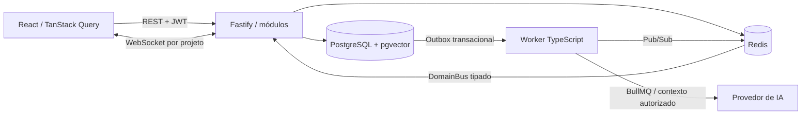

# Arquitetura e decisões

O núcleo é um monólito modular, com processos separados para HTTP/WebSockets e trabalho assíncrono. Todos os fontes executáveis, configurações programáveis, scripts e testes são TypeScript. HTML, CSS, JSON, YAML e Markdown são formatos declarativos de suporte; JavaScript emitido em `dist` é artefato de build.

## Fronteiras

| Módulo     | Responsabilidade                                            |
| ---------- | ----------------------------------------------------------- |
| Auth       | Identidade, sessão, OAuth/OIDC e autorização da conta ativa |
| Diretório  | Perfis, capacidade e catálogo de áreas                      |
| Projetos   | Catálogo, arquivamento, vínculos e ciclos                   |
| Tarefas    | Backlog, execução, checklist, referências e comentários     |
| Dashboards | Leitura agregada por ator e escopo                          |
| Realtime   | Autenticação de conexão, sala e entrega de eventos          |
| Worker     | Publicação da outbox e inferência assíncrona                |
| Shared     | Contratos validados nos dois lados da rede                  |

Os módulos compartilham um PostgreSQL e transações explícitas com `pg`. Identificadores recebidos são validados com Zod e consultas usam parâmetros. Foreign keys compostas garantem que sprint, responsável e épico pertençam ao mesmo projeto da tarefa. O código ainda valida tipo do épico, existência e estado da sprint com mensagens de domínio.

## RBAC em duas camadas

A área expressa especialidade; o papel expressa autoridade. `LEADER` no sistema só pode gerir um projeto quando também tem `LEADER` no vínculo. `MEMBER` não obtém privilégios administrativos por um vínculo incorreto. Diretoria tem visão global. Membros veem projetos vinculados e alteram somente suas tarefas (ou cards criados por eles que ainda não tenham responsável). Priorização, alocação e escopo exigem liderança contextual.

Gente e Gestão tem leitura global **somente do mapa de alocação**, uma capacidade específica para seu trabalho; não recebe acesso implícito aos cards dos projetos. Líderes veem alocação e carga apenas nos projetos que lideram. Diretório expõe perfis de colegas de projeto e o próprio perfil; a diretoria vê todos. Para ampliar o time com pessoas ainda fora do diretório do líder, a diretoria faz o vínculo inicial.

Um projeto desconhecido ou sem vínculo retorna 404, evitando confirmar existência. Um card é consultado sempre pelo par `(projectId, taskId)`. Sessões, resumos, métricas, comentários e conexões WebSocket também passam pelas políticas. Mudanças de papel e conta ativa são consultadas a cada request; o papel não é confiado ao JWT.

## Concorrência, escopo e eventos

Mutações no workspace serializam pelo registro do projeto e bloqueiam tarefas/sprints durante a transação. É uma escolha conservadora para a escala de uma EJ. `version` permite rejeitar atualizações baseadas em estado antigo com 409. A SPA cancela queries em andamento antes do update otimista e restaura o snapshot em caso de erro.

Sprint planejada aceita mudanças. Após iniciar, a composição, pontos e hierarquia do escopo ficam congelados. Status e conteúdo continuam editáveis durante a execução; sprint encerrada não aceita alterações de tarefas. Esta primeira versão exige conclusão das tarefas antes do encerramento e não implementa carryover. Projeto arquivado fica para leitura.

A alteração de status grava tarefa, atividade, auditoria e `TaskStatusChanged` na outbox **na mesma transação**. O worker busca lotes com `FOR UPDATE SKIP LOCKED`, publica em Redis e marca o envio. Uma falha após publicar e antes de confirmar pode duplicar o evento: a entrega é **pelo menos uma vez**, não exatamente uma vez. Clientes invalidam queries, uma operação idempotente. Redis Pub/Sub não retém eventos para clientes desconectados; a reconexão e o polling refazem a leitura autoritativa. O worker deve estar ativo para publicação da outbox.

O cache do mapa dura 15 segundos, é separado por usuário, conjunto atual de projetos autorizados e revisão. Validação do escopo ocorre antes de ler o cache. Alterações de status incrementam a revisão; alterações de capacidade/alocação convergem pelo TTL. WebSockets revalidam conta e vínculo por entrega e fecham na expiração do access token; reconexões usam backoff e refresh.

## Autenticação e conteúdo

Google usa Authorization Code + PKCE S256, estado no Redis, nonce, assinatura/audiência/issuer OIDC e e-mail verificado. Cookie temporário de vínculo OAuth usa SameSite=Lax para aceitar o retorno do Google; o cookie de refresh permanece Strict. Login local usa Argon2id e rate limit. Não há autoprovisionamento OAuth nem signup público.

Refresh tokens opacos são armazenados como SHA-256, rotacionados sob lock e agrupados por família. Reutilização revoga a família. Logout revoga a família do refresh; access tokens já emitidos duram até 15 minutos, respeitando desativação da conta. Cookies exigem Secure e frontend HTTPS em produção. A SPA guarda o JWT apenas em memória e serializa renovações simultâneas dentro da aba. Duas abas renovando o mesmo cookie ao mesmo tempo podem causar revogação conservadora por replay; coordenação entre abas é evolução prevista.

Helmet, CORS restrito, verificação de Origin em mutações e autenticação explícita do WebSocket formam as camadas HTTP. Nenhum token vai em URL; os logs de request descartam a query string, incluindo códigos OAuth. JWT, cookies e cabeçalhos sensíveis são redigidos. Markdown permanece texto no banco e é renderizado sem HTML bruto, passando por `rehype-sanitize`. Links de referência aceitam somente HTTPS.

`audit_log` recusa UPDATE, DELETE e TRUNCATE por trigger; o código só faz INSERT. Isso protege operações normais, mas não torna um superusuário de banco incapaz de alterar a infraestrutura. Antes de produção, use credenciais distintas de migração e execução, sem DDL, e exporte auditoria para retenção externa conforme a política da EJ. O Compose fornece credenciais **de desenvolvimento** e volumes persistentes; não define backups, TLS do banco, observabilidade ou alta disponibilidade.

## IA e memória institucional

O job de resumo transporta apenas ator e projeto. O worker revalida autorização antes de ler contexto e antes de disponibilizar o resultado, limita as tarefas consideradas, trata dados como entrada não confiável e registra metadados da inferência. O resultado é uma sugestão, nunca uma mutação automática. Não há fallback que finja uma resposta de IA quando o provedor está ausente.

`knowledge_chunks` já contém namespace por projeto, metadados JSONB/GIN e vetores de 1536 dimensões com índice HNSW. Essa dimensão deverá ser compatível com o modelo de embedding escolhido. **Ainda não há ingestão, geração de embeddings, busca vetorial ou RAG operacional**. A próxima etapa é indexar decisões/documentos por projeto, validar escopo antes da recuperação e retornar citações para suas fontes. Resumos de sprint, decomposição assistida de backlog, identificação de risco de alocação e onboarding semestral podem reutilizar fila, políticas e auditoria existentes.

## Próximos incrementos

1. Gestão dinâmica de áreas/cargos, convites e recuperação de acesso.
2. Ordenação manual do backlog, carryover com histórico e burndown por dia.
3. Ingestão/RAG autorizado com citações e exclusão/reindexação de conteúdo.
4. Outbox para outros eventos e monitoramento de atraso/retries das filas.
5. Coordenação de refresh entre abas, limites de uso/custo por usuário e cobertura de revogação em sessões longas.
6. Deploy Node com proxy HTTPS, credenciais de menor privilégio, backups restauráveis e observabilidade.
